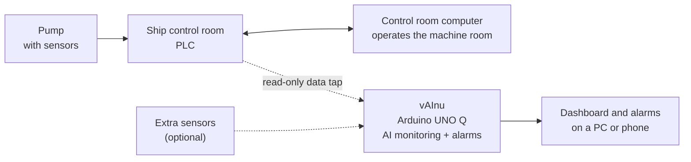

# vAInu System Flow Chart

vAInu is a standalone AI monitor. It listens to the pump data that already flows between the PLC and the control room computer, and raises alarms on its own. It never controls anything.

## How it works

1. The pump sensors feed the ship's PLC.
2. The PLC sends data to the control room computer, as it always does.
3. vAInu taps that PLC-to-computer link and reads the same data.
4. vAInu watches the pumps with its own AI model and raises alarms when something looks wrong.

## Why it is easy to add

- **Quick to install.** It taps an existing cable connection; no rewiring of the pump or control system.
- **No interference.** It only listens. It has no control output, so it cannot change or stop the machine.
- **Works anywhere.** The same setup fits a ship or a normal factory.
- **Scalable.** Add more pumps or more external sensors whenever you need them.
