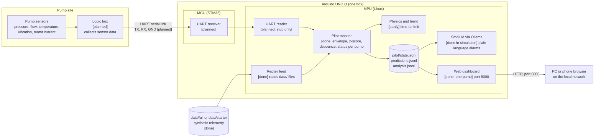

# vAInu System Flow Chart

This page shows how data moves through the pump-sensor system, from the sensors to the dashboard on the local network. The Arduino UNO Q and SmolLM are drawn in the same box because they run on the same board.

Status tags: **[done]** works today, **[partly]** built but not finished, **[planned]** not built yet.

## Boxes explained

### Pump site

**Pump sensors.** Each pump has sensors for pressure (suction and discharge), flow, fluid and bearing temperature, motor current, power, speed, and vibration. Vibration and temperature are sampled at different rates on different pump tiers.

**Logic box [planned].** A separate box that collects the sensor readings and sends them to the UNO Q over a single serial link. It is the only path into the board. It has no control output, so it cannot change the pump.

### Arduino UNO Q (one box)

The UNO Q has two processors that talk to each other:

- **MCU (STM32)**, the real-time side. It will receive frames from the logic box and pass them to Linux. Not built yet.
- **MPU (Linux)**, the main side. It runs all the Python code, SmolLM, and the dashboard.

**UART receiver [planned]** (on the MCU). Reads the serial frames from the logic box.

**UART reader [planned, stub only]** (on the MPU). Will read the frames forwarded by the MCU. The current `UartFeed` is a stub that raises an error until the logic box exists.

**Replay feed [done].** Reads the recorded telemetry in `data/` and sends one sample at a time to the pilot. This is how the board is tested without sensors. The loader handles both the starter file (`telemetry.csv.gz`) and the full tier's parquet partitions.

**Pilot monitor [done].** The core of the system. For each pump it:

1. compares each reading with the healthy range for that pump and operating mode (median and MAD, the "envelope"),
2. turns the difference into a z-score, and smooths it over time,
3. only raises alarms in RUNNING mode,
4. confirms alarms after 3 minutes and escalates after 30 minutes (debounce),
5. writes the latest status to `pilot/state.json` and each change to `pilot/predictions.jsonl`.

It only uses data up to the current time, so it cannot look ahead.

**Physics and trend [partly].** Estimates how long until a limit is reached, for example "vibration hits alarm in about 38 h", by fitting a trend over the last 12 hours. The math is written; it is not yet part of the pilot output.

**SmolLM via Ollama [done in simulation].** The small language model (`smollm2:1.7b`) turns each alarm record into plain-language text. It never changes the alarm status or the numbers. Every answer is checked: it must be valid JSON, use only numbers from the input, and avoid unsafe wording. It is off by default (`[llm] enabled = false`), so the board writes template text instead.

**pilot/ files.** Output files written by the pilot and read by the dashboard and the narrator. They are not tracked by git.

**Web dashboard [done, one pump on the board].** A small server on port 8000 showing asset status (`OK`, `WATCH`, `ALARM`, `IDLE`), a severity score from 0 to 100, channel charts, and the narration panel. It has no login, so it must only run on a trusted network.

### Outside the board

**Data folder.** Synthetic pump telemetry from the RETROFIT AI 2026 simulator. It is read-only. Used for testing and replay until real sensors are connected.

**PC or phone browser.** Opens the dashboard at `http://10.20.3.13:8000` on the same network.

## Data path summary

| Mode | Source | Path through the system | Status |
|---|---|---|---|
| Replay test | `data/` files | Replay feed → pilot → state files → dashboard | [done] |
| Real-time replay | `data/` files, paced | Stream → pilot → state files → dashboard | [done] on PC and board (one pump on board) |
| Live sensors | Pumps | Sensors → logic box → UART → MCU → MPU → pilot → dashboard | [planned] |

## Tests done

### Python tests (on the PC)

The test files are in `tests/`. Run them with `scripts/run_board.sh test`, or one at a time with `.venv/bin/python tests/<file>.py`.

| Test file | What it checks | Result |
|---|---|---|
| `test_debounce.py` | Confirm and escalate timing for alarms | Pass |
| `test_narration.py` | SmolLM output validation, stub server | Pass |
| `test_pilot.py` | Pilot status logic on replayed data | Pass |
| `test_stream.py` | Frame streaming and parsing | Pass |
| `test_web_ui.py` | Dashboard server and pages | Pass |
| `test_data_input.py` | Loading the full tier's parquet partitions | Pass (full tier) |
| `test_labels_math.py` | Labels and robust statistics | Pass (full tier) |
| `test_physics.py` | Physics checks | Pass (full tier) |
| `test_trend.py` | Trend and time-to-limit | Pass (full tier) |

The last four need full-tier telemetry. The project's `data/full` folder has none, so they were run with `VAINU_DATA_DIR` pointing to the complete copy in the `since` folder. Without it, they fail with "no telemetry partitions".

### Manual checks (on the PC)

- Full-tier envelope for PUMP-01 (all 7 days, all 14 channels): built in 5.3 s, peak memory about 630 MB.
- Full-tier envelope for all 12 pumps: not run on the PC; it would need roughly 7 GB. The board, with 4 GB RAM, ran out of memory (`killed`).
- Web dashboard started on the PC with the PUMP-01 data: returned HTTP 200 on port 8000, then stopped.
- `run_board.sh` syntax check (`bash -n`): pass.

### Arduino tests (on the board, confirmed by the team)

| Test | Result |
|---|---|
| Board test suite (`tests/test_*.py`) | Pass (confirmed) |
| Simulation run on the board (replay → pilot → state files) | Works (confirmed) |
| SmolLM narration on the board (simulation) | Works (confirmed) |
| Web dashboard streaming on the board | Works (confirmed), with one pump only |
| Stream about 10 minutes, UI buttons checked, normal and fast replay | Seemed to work in a quick test; **not yet fully verified** |

**Limit found:** the full dataset (all 12 pumps) was too large for the board's 4 GB of RAM. The web dashboard was run with PUMP-01 data only (all 7 days, all 14 channels).

**Still needed:** longer and repeated runs, and a check of every UI button and replay speed, before this counts as fully verified.

**Not tested:** real sensors. Everything above is simulation using recorded synthetic data. The logic box, the UART link and the MCU receiver have not been built or tested.

The MCU firmware and the UART link to the logic box have no tests yet, because neither is built.
