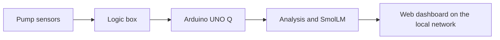

# vAInu — Pump Sensor Project

vAInu watches pump sensors and warns about developing faults before they cause a stop. It runs on an Arduino UNO Q, a small board with a Linux processor and a microcontroller.

Built for the **SinceAI 2026 Hackathon** in Turku.

## What it does

- Reads pump telemetry (pressure, flow, temperature, vibration, and more).
- Compares it with what "healthy" looks like for that pump and its operating mode.
- Raises early warnings and estimates how long until a limit is reached.
- Explains each warning in plain language (SmolLM, planned).

vAInu is **advisory only**. It never controls the pump and never writes to hardware. A person always makes the decision.

## How it fits together



The UNO Q receives data from the logic box over a single serial link. It has no other inbound connections.

## Quick start

You need Python 3.11 or newer.

```bash
python3 -m venv .venv
.venv/bin/pip install -r requirements.txt

# Replay the starter data through the pilot monitor
.venv/bin/python scripts/pilot_run.py --data data/starter --speed 0

# Start the dashboard, then open http://127.0.0.1:8000
.venv/bin/python scripts/web_ui.py --data data/starter
```

Run the tests with:

```bash
for f in tests/test_*.py; do .venv/bin/python "$f" || break; done
```

> `config.toml` points at `data/full` by default, but this repo does not include its telemetry files. Use `--data data/starter` until a full copy is available.

## Documentation

| File | What it covers |
|---|---|
| [`plan.md`](plan.md) | Goal, approach, phases, and current status |
| [`to-do.md`](to-do.md) | Open tasks, grouped by area |
| [`Workflow.md`](Workflow.md) | Reaching the board and running the dashboard |
| [`arduino_uno_q_install.md`](arduino_uno_q_install.md) | Board setup, Ollama and SmolLM install, board test |
| [`bom.md`](bom.md) | Hardware list |
| [`skill_data.md`](skill_data.md) | Rules for working with the dataset |
| [`skills/python-style.md`](skills/python-style.md) | Python coding style |

## Repository layout

- `config.toml` — all project settings.
- `main.py` — entry point.
- `src/` — library modules (data loading, labels, math, physics, pilot monitor, web UI).
- `scripts/` — runnable pipelines (pilot replay, dashboard, KPI gate).
- `tests/` — test scripts.
- `data/` — pump telemetry dataset. Read-only.
- `pilot/` — generated output (not tracked by git).
- `skills/` — coding and data guidelines.

## Limitations

- The data is synthetic. There is no field evidence yet.
- The dashboard has no login. Run it only on a trusted network.
- SmolLM narration is not connected to the dashboard yet.

## Team and license

Developed by Paavo Gaidach and Matias Hirvonen.

Project code is MIT, see [`LICENSE`](LICENSE). The original dataset is © Since AI ry, licensed under CC BY 4.0.

## Acknowledgements

Thanks to **Majos Hacking League** for providing the Arduino UNO Q.

Development used [OpenCode](https://opencode.ai) with Claude Haiku 5.5.
