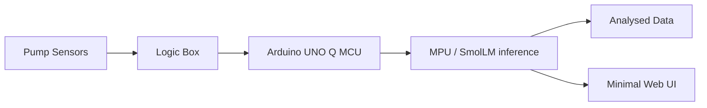

# vAInu — Pump Sensor Project

> Edge AI for predictive pump maintenance, running on an Arduino UNO Q.

Built for the **SinceAI 2026 Hackathon** in Turku.

**Main objective:** build the prediction algorithm that SmolLM uses to analyse pump telemetry and forecast faults.

**Scope:** designed to be widely retrofit-compatible — usable across a wide selection of pumps and motors in both maritime and industrial environments. Operates in **maintenance prediction mode**, forecasting faults before they occur.

## Overview

Pump sensors stream telemetry to a logic box, which forwards it to an **Arduino UNO Q**. The UNO Q's MPU runs a **SmolLM** model locally, analysing the data and serving results to a minimal web UI on the local network. The Arduino only receives data from the pump logic circuit and outputs results elsewhere — it has no other inbound connections.



See [`plan.md`](plan.md) for the full architecture and roadmap, and [`to-do.md`](to-do.md) for the task breakdown.

## Architecture

- 📡 Pump sensors → logic box (collect/forward telemetry)
- 🔗 Logic box → Arduino UNO Q (single inbound data path; MCU receives, MPU runs LLM inference)
- 🖥️ Arduino UNO Q → minimal web UI (live values + predictions, local network only)

## Repository Structure

- `config.toml` — all project settings (paths, tiers, assets, channels, analysis).
- `main.py` — entry point; orchestrates the modules in `src/`.
- `src/` — library code:
  - `data_input.py` — load and split telemetry (+ asset nameplate joins, quality-flag helpers).
  - `labels.py` — aligns event / benign-window labels onto telemetry rows.
  - `math.py` — robust statistics, modified z-scores, group-aware rolling helpers.
  - `physics.py` — pump-curve, flow, efficiency and thermal residual features.
  - `web_ui.py` — first-version local dashboard (stdlib HTTP server + JSON API).
  - `ui.py` — matplotlib plotting helpers.
  - `config.py` — reads `config.toml`.
- `scripts/` — runnable pipelines:
  - `sanity_gate.py` — baseline KPI gate: benign false-alarm rate + early-warning lead time vs the benchmark's own detection clock.
  - `web_ui.py` — serves the local dashboard (asset status, latest values, channel chart, replay).
- `tests/` — plain-assert test scripts (run with `.venv/bin/python tests/test_*.py`).
- `data/` — pump telemetry dataset (`full/` + `starter/`). **Read-only**; the only data source.
- `skills/` — coding and data guidelines for humans and LLMs.
- `skill_data.md` — notes about the dataset and its handling.
- `plan.md` / `to-do.md` / [`bom.md`](bom.md) — roadmap, task breakdown, and minimal hardware BOM.

## Web UI (first version)

A dependency-free local dashboard shows the current alarm surface over the
bundled telemetry:

```bash
python scripts/web_ui.py --data data/full
```

Open <http://127.0.0.1:8000>. Use `--host 0.0.0.0` to expose it on the local
network (the prototype has no authentication, so trusted LANs only).

The first version includes:

- asset list with `OK` / `WATCH` / `ALARM` / `IDLE` status,
- latest values and robust modified z-scores per channel,
- top deviating channels at the selected sample,
- a channel chart with alarm bands, window selector, and replay controls.

> The full tier needs its telemetry parquet partitions
> (`data/full/telemetry/`), which are excluded by `.gitignore`. If they are
> missing from the checkout, point `--data` at the original participant
> bundle. The dashboard uses the same robust
> envelope math as `scripts/sanity_gate.py`; SmolLM narration is not wired yet.

## Tech Stack

- Python / MicroPython, PEP 8, simple but effective.
- `pandas`, `numpy`, `scipy`, `matplotlib`.
- SmolLM (GGUF via llama.cpp) running on the UNO Q MPU.

## Acknowledgements

🙏 Special thanks to **Majos Hacking League** for providing the **Arduino UNO Q** used in this project.

## License

See [`LICENSE`](LICENSE). Project code is MIT (© 2026 P. Gaidach & M. Hirvonen). Original dataset © Since AI ry, CC BY 4.0.
