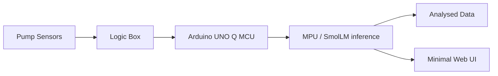

# vAInu — Pump Sensor Project

> Edge AI for predictive pump maintenance, running on an Arduino UNO Q.

Built for the **SinceAI 2026 Hackathon** in Turku.

**Main objective:** build the prediction algorithm that SmolLM uses to analyse pump telemetry and forecast faults.

**Scope:** designed to be widely retrofit-compatible — usable across a wide selection of pumps and motors in both maritime and industrial environments. Operates in **maintenance prediction mode**, forecasting faults before they occur.

## Overview

Pump sensors stream telemetry to a logic box, which forwards it to an **Arduino UNO Q**. The UNO Q's MPU runs a **SmolLM** model locally, analysing the data and serving results to a minimal web UI on the local network. The Arduino only receives data from the pump logic circuit and outputs results elsewhere — it has no other inbound connections.

See [`plan.md`](plan.md) for the full architecture and roadmap, and [`to-do.md`](to-do.md) for the task breakdown.

## Architecture

- 📡 Pump sensors → logic box (collect/forward telemetry)
- 🔗 Logic box → Arduino UNO Q (single inbound data path; MCU receives, MPU runs LLM inference)
- 🖥️ Arduino UNO Q → minimal web UI (live values + predictions, local network only)

## Repository Structure

- `data/` — pump telemetry dataset (full + starter tiers). Treat as the only data source.
- `skills/` — installed agent skills (ei-build-arduino-uno-q-app-lab) + project skill notes.
- `tests/` — tests.
- `skill_data.md` — instructions about the data and coding style.

## Tech Stack

- Python / MicroPython, PEP 8, simple but effective.
- `pandas`, `numpy`, `scipy`, `matplotlib`.
- SmolLM (GGUF via llama.cpp) running on the UNO Q MPU.

## Acknowledgements

🙏 Special thanks to **Majos Hacking League** for providing the **Arduino UNO Q** used in this project.

## License

See [`LICENSE`](LICENSE). Project code is MIT (© 2026 P. Gaidach & M. Hirvonen). Original dataset © Since AI ry, CC BY 4.0.
