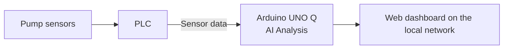

# vAInu — Pump Sensor Project

vAInu helps spot pump problems early. It reads sensor data, looks for signs that something may be going wrong, and shows warnings on a local web dashboard. The analysis runs on an Arduino UNO Q.

Built for the **SinceAI 2026 Hackathon** in Turku.

## What it does

- Reads pump sensor data, such as pressure, flow, temperature, and vibration.
- Checks for readings that are unusual for the pump.
- Shows early warnings and estimates how soon a reading may reach a limit.
- Plans to explain warnings in plain language (SmolLM).

vAInu is **advisory only**. It never controls the pump and never writes to hardware. A person always makes the decision.

## How it fits together



The PLC sends sensor data to the Arduino UNO Q over a single serial connection. The Arduino analyzes the data and makes the dashboard available on the local network.

## Quick start

You need Python 3.11 or newer.

```bash
python3 -m venv .venv
.venv/bin/pip install -r requirements.txt

# Replay the starter data through the pilot monitor
.venv/bin/python scripts/pilot_run.py --data data/starter --speed 0

## Web UI (first version)

A dependency-free local dashboard shows the current alarm surface over the
bundled telemetry:

```bash
python scripts/web_ui.py --data data/full
```

Open <http://127.0.0.1:8000>. Use `--host 0.0.0.0` to expose it on the local
network (the prototype has no authentication, so trusted LANs only).

The first version includes:

- asset list with `OK` / `WATCH` / `ALARM` / `IDLE` status,
- an alarm severity score from 0 to 100 (the z threshold lands at 80),
- latest values and robust modified z-scores per channel,
- top deviating channels at the selected sample,
- a channel chart with alarm bands, window selector, and replay controls.

The first build scores every asset in parallel processes (one per logical CPU
by default) and writes the finished alarm surface to `cache/web_ui`, so a
restart skips the rebuild:

```bash
python scripts/web_ui.py --data data/full --workers 8    # cap the process count
python scripts/web_ui.py --data data/full --rebuild      # ignore the cache
python scripts/web_ui.py --data data/full --cache-dir "" # disable the cache
```

`[compute] workers` in `config.toml` sets the default (`0` = auto), and
`[web_ui] cache_dir` sets where the surface is stored.

> The full tier needs its telemetry parquet partitions
> (`data/full/telemetry/`), which are excluded by `.gitignore`. If they are
> missing from the checkout, point `--data` at the original participant
> bundle. The dashboard uses the same robust
> envelope math as `scripts/sanity_gate.py`. SmolLM narration is a separate
> batch step: `scripts/narrate.py` (see `[llm]` in `config.toml`).

## Tech Stack
# Start the dashboard, then open http://127.0.0.1:8000
.venv/bin/python scripts/web_ui.py --data data/starter
```

Run the tests with:

```bash
for f in tests/test_*.py; do .venv/bin/python "$f" || break; done
```

> `config.toml` points at `data/full` by default, but this repo does not include its telemetry files. Use `--data data/starter` until a full copy is available.

## Documentation

| File | What it covers |
|---|---|
| [`plan.md`](plan.md) | Goal, approach, phases, and current status |
| [`to-do.md`](to-do.md) | Open tasks, grouped by area |
| [`Workflow.md`](Workflow.md) | Reaching the board and running the dashboard |
| [`arduino_uno_q_install.md`](arduino_uno_q_install.md) | Board setup, Ollama and SmolLM install, board test |
| [`bom.md`](bom.md) | Hardware list |
| [`skill_data.md`](skill_data.md) | Rules for working with the dataset |
| [`skills/python-style.md`](skills/python-style.md) | Python coding style |

## Repository layout

- `config.toml` — all project settings.
- `main.py` — entry point.
- `src/` — library modules (data loading, labels, math, physics, pilot monitor, web UI).
- `scripts/` — runnable pipelines (pilot replay, dashboard, KPI gate).
- `tests/` — test scripts.
- `data/` — pump telemetry dataset. Read-only.
- `pilot/` — generated output (not tracked by git).
- `skills/` — coding and data guidelines.

## Limitations

- The data is synthetic. There is no field evidence yet.
- The dashboard has no login. Run it only on a trusted network.
- SmolLM narration runs as a batch job and is off by default (`[llm] enabled = false`). Its text is checked, but it is still advisory.

## Team and license

Developed by Paavo Gaidach and Matias Hirvonen.

Project code is MIT, see [`LICENSE`](LICENSE). The original dataset is © Since AI ry, licensed under CC BY 4.0.

## Acknowledgements

Thanks to **Major League Hacking** for providing the Arduino UNO Q.

Development used [OpenCode](https://opencode.ai) with Claude Haiku 5.5.
